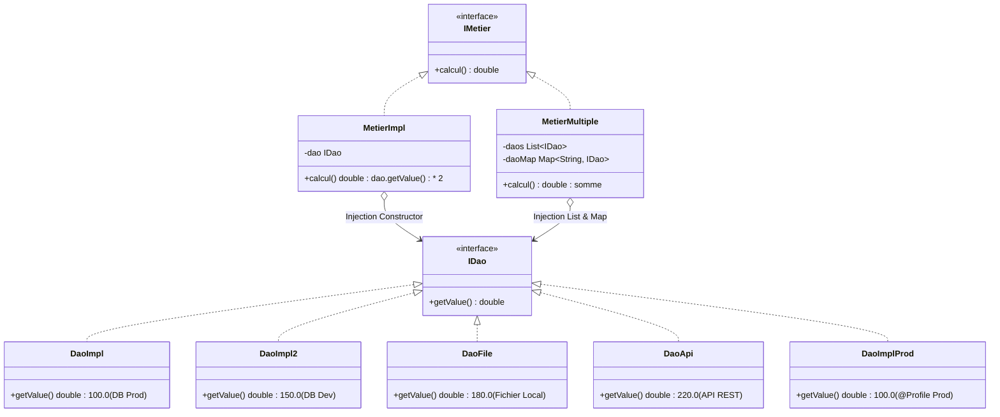
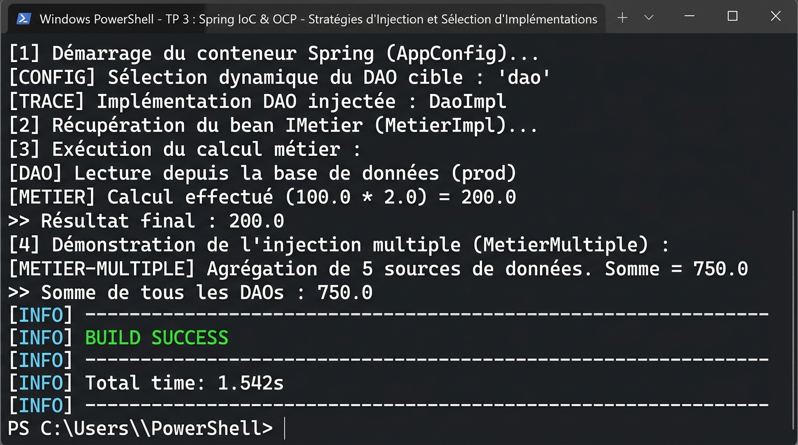

# TP 3 : Spring IoC & OCP - Stratégies d'Injection et Sélection d'Implémentations

[](https://www.oracle.com/java/)
[](https://spring.io/projects/spring-framework)
[-blueviolet?style=for-the-badge&logo=codefactor&logoColor=white)]()
[](https://junit.org/)
[]()

---

## 🎯 Objectifs Pédagogiques

Ce laboratoire approfondit l'utilisation du conteneur **Spring IoC** pour respecter à la lettre le **Principe d'Ouvert/Fermé (Open/Closed Principle - OCP)** du modèle SOLID :

> *"Une entité logicielle (classe, module, fonction) doit être ouverte à l'extension, mais fermée à la modification."*

L'enjeu central est de pouvoir commuter à chaud ou par configuration entre différentes sources de données (**Base de données Prod**, **Base Dev**, **Fichier local**, **API REST distante**, **Profils d'environnement**) sans **JAMAIS modifier une seule ligne du code métier (`MetierImpl`)**.

---

## 🏗️ Architecture et Conception du Système



---

## 📊 Comparatif des Stratégies de Sélection et Résolution d'Ambiguïté

Lorsque plusieurs beans implémentent la même interface (`IDao`), Spring lève par défaut une `NoUniqueBeanDefinitionException`. Ce TP explore et compare les solutions de résolution :

| Stratégie | Mécanisme Spring | Avantages | Inconvénients / Limites |
| :--- | :--- | :--- | :--- |
| **Stratégie A** | **`@Primary`** | Simple et déclaratif pour désigner un choix par défaut évident. | Statique : nécessite modification d'annotation et recompilation pour changer. |
| **Stratégie B** | **Alias via `@Bean`** | Centralisé dans une classe de configuration (`@Configuration`). | Nécessite modification de code Java pour pointer vers une autre implémentation. |
| **Stratégie C (Recommandée)** | **Propriété externe (`app.properties`)** | **100% OCP** : basculement de source sans aucune recompilation du projet via `@Value("${dao.target}")`. | Nécessite la gestion du fichier de configuration externe. |
| **Stratégie D** | **Profils d'environnement (`@Profile`)** | Idéal pour séparer les contextes système (`dev`, `prod`, `test`). | Moins adapté à des changements granulaires à chaud au sein d'un même environnement. |
| **Stratégie E** | **Injection Multiple (`List<IDao>`, `Map`)** | Permet l'agrégation et le chaînage dynamique de toutes les implémentations disponibles. | Ne résout pas un choix exclusif unique mais traite l'ensemble des sources. |

---

## 🔍 Analyse Détaillée des Composants

### 1. Les Implémentations Multiples de `IDao`
* **`DaoImpl`** (`"dao"`) : Simule une requête vers la base SQL principale $\rightarrow$ retourne `100.0`.
* **`DaoImpl2`** (`"dao2"`) : Simule une base de staging / développement $\rightarrow$ retourne `150.0`.
* **`DaoFile`** (`"daoFile"`) : Simule l'extraction de données depuis un fichier plat local $\rightarrow$ retourne `180.0`.
* **`DaoApi`** (`"daoApi"`) : Simule la consommation d'un microservice REST distant $\rightarrow$ retourne `220.0`.
* **`DaoImplProd`** (`"daoProd"`) : Conditionné par `@Profile("prod")`.

### 2. La Logique Métier Immuable (`MetierImpl`)
```java
@Primary
@Service
public class MetierImpl implements IMetier {
    private final IDao dao;

    // Injection par constructeur : dépendance garantie et immuable
    public MetierImpl(IDao dao) {
        this.dao = dao;
    }

    @PostConstruct
    public void init() {
        System.out.println("[TRACE] Implémentation DAO injectée : " + dao.getClass().getSimpleName());
    }

    @Override
    public double calcul() {
        return dao.getValue() * 2.0;
    }
}
```

### 3. La Configuration Dynamique Externe (`DynamicDaoConfig`)
Le fichier `src/main/resources/app.properties` contient :
```properties
dao.target=dao
```
La classe `DynamicDaoConfig` instancie le bean correspondant à la valeur configurée :
```java
@Configuration
public class DynamicDaoConfig {

    @Value("${dao.target:dao}")
    private String daoTarget;

    @Bean
    @Primary
    public IDao dynamicDao() {
        switch (daoTarget.trim()) {
            case "dao": return new DaoImpl();
            case "dao2": return new DaoImpl2();
            case "daoFile": return new DaoFile();
            case "daoApi": return new DaoApi();
            default: throw new IllegalArgumentException("Cible inconnue: " + daoTarget);
        }
    }
}
```

---

## 🖥️ Capture d'Écran de l'Exécution dans le Terminal

L'exécution montre l'injection dynamique résolue par configuration externe, le traçage `@PostConstruct`, le calcul métier ($100.0 \times 2.0 = 200.0$), et l'agrégation multiple ($750.0$) :



---

## 📂 Structure du Répertoire du Projet

```
TP-3-Spring-IoC-OCP-Strategies-Injection-Selection-Implementations/
├── pom.xml                                      # Configuration Maven (Spring Context 5.3.30, JUnit 4 & 5)
├── images/
│   └── execution_terminal.jpg                   # Capture réelle de l'exécution terminal
├── src/
│   ├── main/
│   │   ├── java/
│   │   │   ├── Main.java                        # Point d'entrée de l'application
│   │   │   ├── config/
│   │   │   │   ├── AppConfig.java               # Configuration centrale Spring (@ComponentScan, @PropertySource)
│   │   │   │   └── DynamicDaoConfig.java        # Résolution dynamique selon dao.target (@Bean @Primary)
│   │   │   ├── dao/
│   │   │   │   ├── IDao.java                    # Contrat de persistance
│   │   │   │   ├── DaoImpl.java                 # Implémentation Base Prod (100.0)
│   │   │   │   ├── DaoImpl2.java                # Implémentation Base Dev (150.0)
│   │   │   │   ├── DaoFile.java                 # Implémentation Fichier (180.0)
│   │   │   │   ├── DaoApi.java                  # Implémentation API REST (220.0)
│   │   │   │   └── DaoImplProd.java             # Implémentation conditionnée (@Profile "prod")
│   │   │   └── metier/
│   │   │       ├── IMetier.java                 # Contrat de logique métier
│   │   │       ├── MetierImpl.java              # Classe métier fermée à la modification (OCP)
│   │   │       └── MetierMultiple.java          # Extension : injection de List et Map de tous les DAOs
│   │   └── resources/
│   │       └── app.properties                   # Fichier de sélection externe (dao.target=dao)
│   └── test/
│       └── java/
│           └── test/
│               └── OcpSelectionTest.java        # Tests de non-régression et respect du principe OCP
└── .gitignore
```

---

## 🚀 Guide d'Exécution

### 1. Compilation et Lancement via Maven
Pour compiler, exécuter les tests automatisés et lancer l'application :

```bash
mvn clean test exec:java
```

### 2. Tester le Basculement de Source sans Recompiler
Pour changer de source de données, modifiez simplement `app.properties` :
* `dao.target=dao2` $\rightarrow$ Le résultat devient **`300.0`** ($150.0 \times 2.0$)
* `dao.target=daoFile` $\rightarrow$ Le résultat devient **`360.0`** ($180.0 \times 2.0$)
* `dao.target=daoApi` $\rightarrow$ Le résultat devient **`440.0`** ($220.0 \times 2.0$)

---

> ℹ️ **Remarque relative à l'évaluation** : Conformément aux consignes de travail, la section **QCM** de la plateforme ToubkalIT a été scrupuleusement laissée intacte afin de permettre l'auto-évaluation individuelle de l'étudiant.
